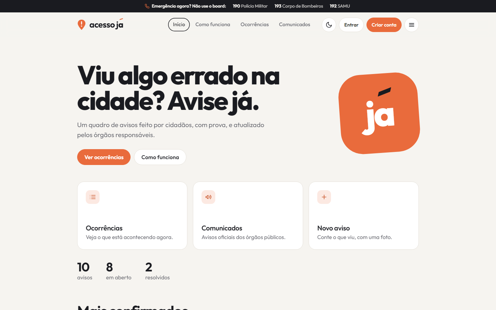
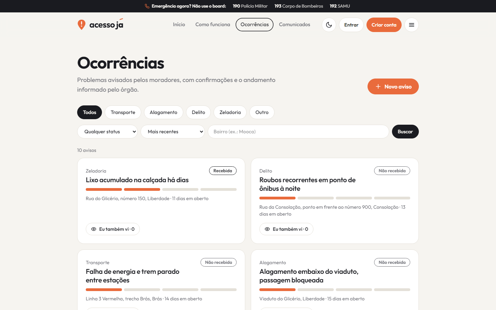
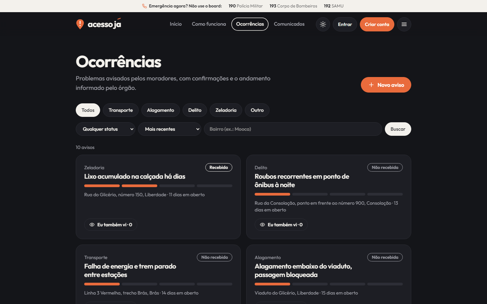
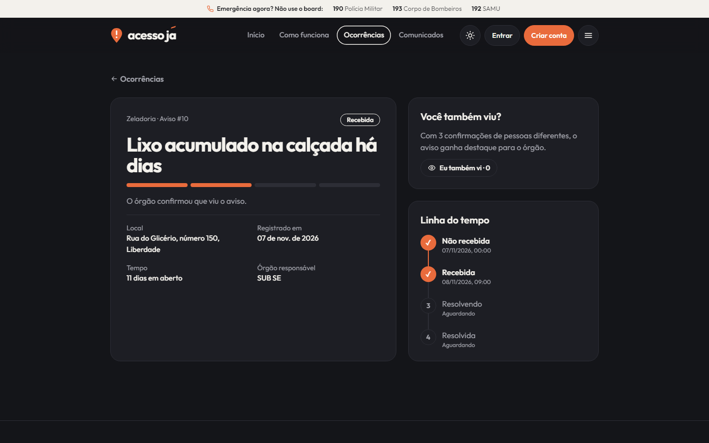
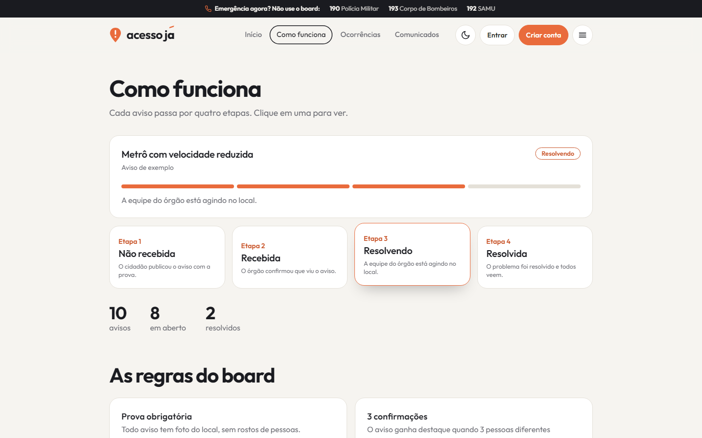
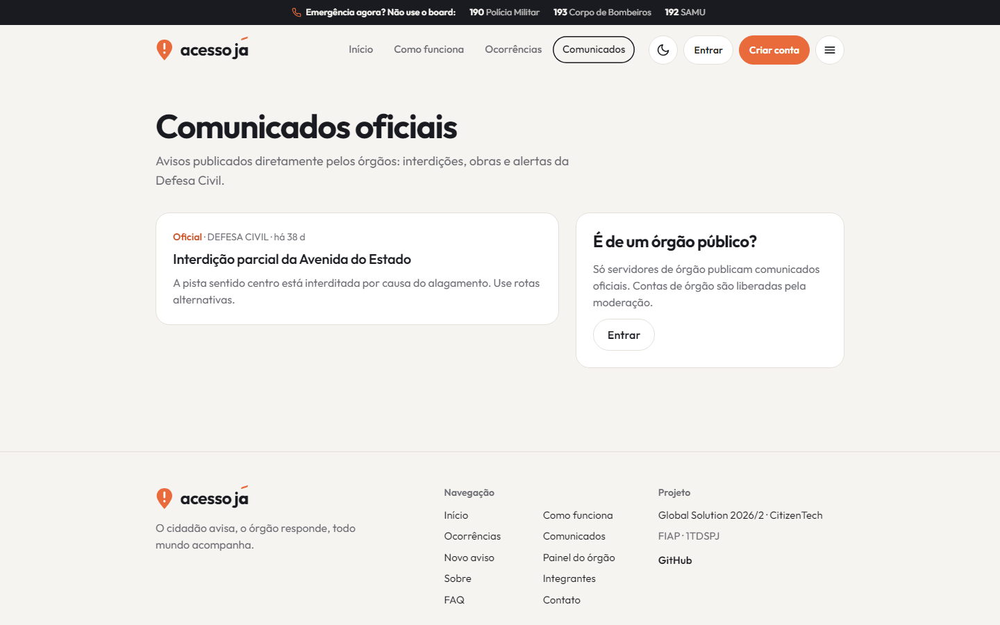
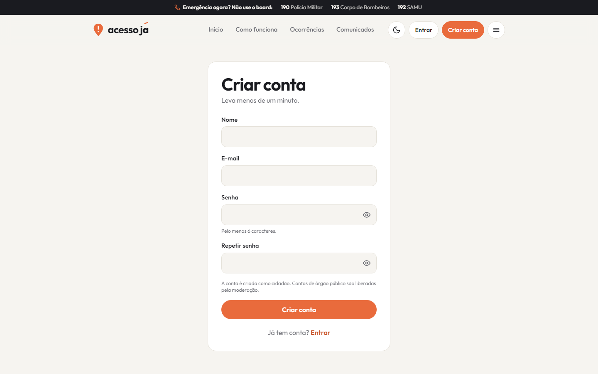
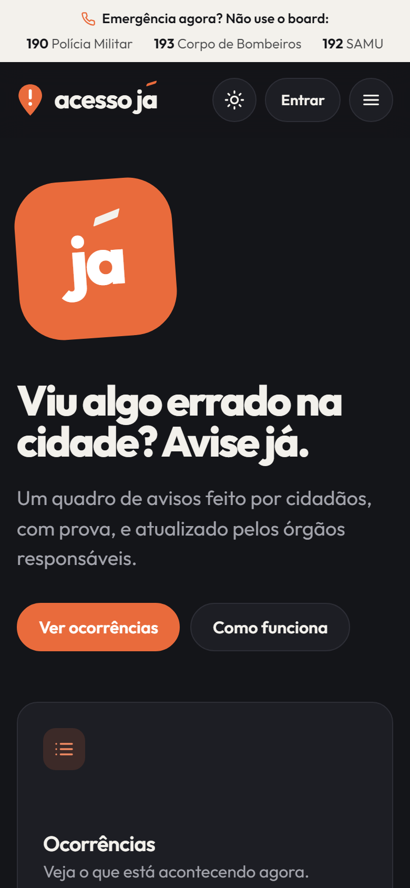
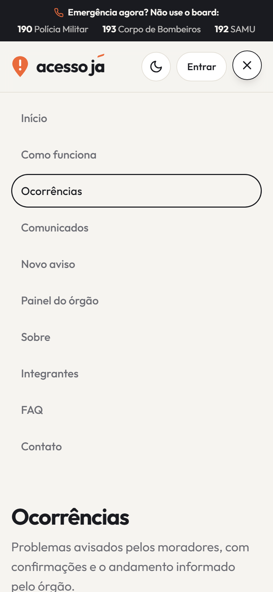

<div align="center">

<picture>
  <source media="(prefers-color-scheme: dark)" srcset="docs/marca/logo-escuro.svg">
  
</picture>

### O cidadão avisa, o órgão responde, todo mundo acompanha.

Board público de avisos urbanos com prova, confirmação dos moradores e status atualizado pelo órgão responsável.

<br>


[**Ver o site**](https://acessoja-app.vercel.app) · [**API Java**](https://acesso-ja-api.onrender.com/api/v1) · [**Vídeo**](https://youtu.be/vq6LTrvuNKI) · [**Equipe**](#-equipe)

</div>

---

## 📌 Sumário

- [Sobre o projeto](#-sobre-o-projeto)
- [Funcionalidades](#-funcionalidades)
- [Como funciona](#-como-funciona)
- [Telas](#-telas)
- [Tecnologias](#-tecnologias)
- [Estrutura de pastas](#-estrutura-de-pastas)
- [Rotas](#-rotas)
- [Integração com a API Java](#-integração-com-a-api-java)
- [Como executar](#-como-executar)
- [Links](#-links)
- [Equipe](#-equipe)
- [Contato](#-contato)

---

## 💡 Sobre o projeto

O **Acesso Já** é uma CitizenTech criada para a **Global Solution 2026/2 da FIAP**, no curso de Análise e Desenvolvimento de Sistemas.

**O problema.** Quem mora em cidade grande convive com metrô com falha, ruas alagadas, delitos recorrentes e problemas de zeladoria. As pessoas denunciam, mas quase nunca sabem se o poder público recebeu, está resolvendo ou já resolveu o caso. Sem resposta, deixam de denunciar.

**A solução.** O Acesso Já tem três peças:

- o cidadão registra o problema com uma foto como prova;
- outros moradores confirmam o aviso;
- o órgão responsável atualiza o andamento, à vista de todos.

Tudo fica público: as etapas, a linha do tempo e há quantos dias o problema está aberto.

> **ODS 11** Cidades e comunidades sustentáveis · **ODS 10** Redução das desigualdades · **ODS 13** Ação contra a mudança do clima

## ✨ Funcionalidades

|     | Funcionalidade               | Descrição                                                                                                                                           |
| --- | ---------------------------- | --------------------------------------------------------------------------------------------------------------------------------------------------- |
| 📋  | **Board público**            | Filtros por categoria, status e bairro, com ordem por mais recentes ou mais confirmados.                                                            |
| 📸  | **Novo aviso com prova**     | Categoria, descrição, local, bairro e foto de até 5 MB, com validação de cada campo.                                                                |
| 👀  | **"Eu também vi"**           | O aviso ganha destaque com 3 confirmações de pessoas diferentes.                                                                                    |
| 🕒  | **Linha do tempo**           | Quatro etapas sem pular nenhuma, com a data de cada mudança e os dias em aberto.                                                                    |
| 🏛️  | **Painel do órgão**          | O servidor avança o status de cada aviso, uma etapa por vez.                                                                                        |
| 📢  | **Comunicados oficiais**     | Os órgãos publicam interdições, obras e alertas.                                                                                                    |
| 🔐  | **Conta e login**            | Criar conta e Entrar, com áreas restritas que mandam para o login.                                                                                  |
| 🌗  | **Modo claro e escuro**      | Segue o tema do sistema e lembra a escolha do usuário.                                                                                              |
| 🚨  | **Emergência fora do board** | Faixa fixa com 190, 193 e 192. No delito, o app pergunta _"Está acontecendo agora?"_ e, se a resposta for sim, orienta a ligar em vez de registrar. |
| 📱  | **Responsivo**               | Testado em 390 × 844, 768 × 1024 e 1440 × 900, sem rolagem horizontal.                                                                              |

## 🔄 Como funciona

| Etapa | Status           | O que significa                         |
| :---: | ---------------- | --------------------------------------- |
|   1   | **Não recebida** | O cidadão publicou o aviso com a prova. |
|   2   | **Recebida**     | O órgão confirmou que viu o aviso.      |
|   3   | **Resolvendo**   | A equipe do órgão está agindo no local. |
|   4   | **Resolvida**    | O problema foi resolvido e todos veem.  |

**Categorias:** 🚇 Transporte · 🌧️ Alagamento · 🚨 Delito · 🧹 Zeladoria · 📌 Outro. Cada uma tem um órgão responsável.

## 🖼️ Telas

Todas as telas abaixo mostram dados reais da API Java.

**Início**



| Ocorrências (modo claro)                                                 | Ocorrências (modo escuro)                                                  |
| ------------------------------------------------------------------------ | -------------------------------------------------------------------------- |
|  |  |

| Detalhe do aviso e linha do tempo                                           | Como funciona                                                               |
| --------------------------------------------------------------------------- | --------------------------------------------------------------------------- |
|  |  |

| Comunicados oficiais                                            | Criar conta                                         |
| --------------------------------------------------------------- | --------------------------------------------------- |
|  |  |

<p align="center">
  
  &nbsp;&nbsp;
  
</p>

## 🛠️ Tecnologias

| Camada        | Tecnologia                                                                          |
| ------------- | ----------------------------------------------------------------------------------- |
| Base          | **React 19** + **Vite 8** + **TypeScript 6**, como aplicação de página única (SPA)  |
| Estilo        | **Tailwind CSS 4**, com tema de cores em variáveis CSS para os modos claro e escuro |
| Rotas         | **React Router 8**, com rotas estáticas, dinâmicas e protegidas                     |
| Formulários   | **React Hook Form**, com validação e mensagens de erro                              |
| Estado global | **Context API**: `TemaContext` e `AuthContext`                                      |
| Requisições   | **Fetch API** (sem Axios)                                                           |
| Deploy        | **Vercel** para o front-end e **Render** para a API Java Spring Boot                |

## 📁 Estrutura de pastas

```
AcessoJa-app/
├── docs/
│   ├── marca/             # logo do projeto (claro, escuro e ícone)
│   └── prints/            # prints das telas usadas neste README
├── public/                # favicon
├── src/
│   ├── assets/            # fotos dos integrantes
│   ├── components/        # componentes reutilizáveis (Botao, CartaoAviso, CampoSenha, RotaProtegida…)
│   ├── context/           # TemaContext (claro/escuro) e AuthContext (sessão)
│   ├── data/              # conteúdo fixo: integrantes, FAQ e menus
│   ├── hooks/             # useRequisicao, useDocumentTitle e useVoltarPara
│   ├── pages/             # uma página por rota
│   ├── services/          # acesso à API com fetch, separado por entidade
│   ├── types/             # interfaces e tipos TypeScript
│   ├── utils/             # formatação de status, datas e categorias
│   ├── index.css          # Tailwind e tema
│   └── main.tsx           # rotas e providers
├── vercel.json            # proxy /api → API Java e fallback da SPA
└── vite.config.ts         # proxy /api em desenvolvimento
```

## 🧭 Rotas

| Rota                    | Página                      | Tipo          |
| ----------------------- | --------------------------- | ------------- |
| `/`                     | Início                      | Institucional |
| `/sobre`                | Sobre                       | Institucional |
| `/integrantes`          | Integrantes                 | Institucional |
| `/integrantes/:id`      | Perfil do integrante        | 🔀 Dinâmica   |
| `/faq`                  | Perguntas frequentes        | Institucional |
| `/contato`              | Contato (formulário)        | Institucional |
| `/como-funciona`        | Etapas interativas          | Solução       |
| `/avisos`               | Ocorrências (board)         | Solução       |
| `/avisos/:id`           | Detalhe do aviso            | 🔀 Dinâmica   |
| `/avisos/novo`          | Novo aviso                  | 🔒 Restrita   |
| `/ocorrencias`          | Comunicados oficiais        | Solução       |
| `/orgao`                | Painel do órgão             | 🔒 Restrita   |
| `/entrar` · `/cadastro` | Entrar e Criar conta        | Conta         |
| `*`                     | Página não encontrada (404) | —             |

## 🔌 Integração com a API Java

As chamadas ficam em `src/services`, um arquivo por entidade. Todas passam pela função `requisicao()` de `src/services/api.ts`, que cuida de quatro coisas:

- tempo limite;
- respostas sem corpo (204);
- mensagens de erro;
- cabeçalho **`X-Usuario-Id`** com o id do usuário logado, que a API exige nas escritas.

Cada tela mostra três estados: **carregando**, **erro** (com botão para tentar de novo) e **sem dados**.

| Método  | Endpoint                                                        | Onde é usado                           |
| ------- | --------------------------------------------------------------- | -------------------------------------- |
| `POST`  | `/auth/cadastro` · `/auth/login` · `/auth/logout`               | Criar conta, Entrar e Sair             |
| `GET`   | `/avisos` · `/avisos/{id}` · `/avisos/{id}/historico`           | Board, detalhe e linha do tempo        |
| `GET`   | `/avisos/estatisticas` · `/categorias` · `/emergencia/contatos` | Números, filtros e faixa de emergência |
| `GET`   | `/ocorrencias-oficiais`                                         | Comunicados                            |
| `POST`  | `/avisos` (multipart)                                           | Novo aviso com foto                    |
| `POST`  | `/avisos/{id}/confirmacoes`                                     | "Eu também vi"                         |
| `PATCH` | `/avisos/{id}/status`                                           | Painel do órgão                        |
| `POST`  | `/ocorrencias-oficiais`                                         | Publicar comunicado                    |

## ▶️ Como executar

**Pré-requisito:** Node.js 20 ou superior.

```bash
git clone https://github.com/AcessoJa-1TDSPJ/AcessoJa-app.git
cd AcessoJa-app
npm install
npm run dev
```

Acesse **http://localhost:5173**.

Em desenvolvimento, o Vite encaminha `/api` para a API Java (`/api/v1`). Para usar outra URL, crie um arquivo `.env` a partir do `.env.example`:

```env
API_PROXY_TARGET=https://acesso-ja-api.onrender.com
```

Build de produção: `npm run build` e depois `npm run preview`.

## 🔗 Links

| Recurso               | Link                                            |
| --------------------- | ----------------------------------------------- |
| 💻 Repositório        | https://github.com/AcessoJa-1TDSPJ/AcessoJa-app |
| 🌐 Aplicação (Vercel) | https://acessoja-app.vercel.app                 |
| ☕ API Java (Render)  | https://acesso-ja-api.onrender.com/api/v1       |
| 🎬 Vídeo (YouTube)    | https://youtu.be/vq6LTrvuNKI                    |

## 👥 Equipe

<div align="center">

<table>
  <tr>
    <td align="center" width="20%">
      <br>
      <b>João Vitor Cruz de Lima</b><br>
      <sub>RM 571277 · 1TDSPJ</sub><br>
      <a href="https://github.com/JoaoVitor-2209">GitHub</a> · <a href="https://www.linkedin.com/in/jo%C3%A3o-vitor-cruz-de-lima-ba4862219">LinkedIn</a>
    </td>
    <td align="center" width="20%">
      <br>
      <b>Matheus Ferreira Antônio</b><br>
      <sub>RM 570933 · 1TDSPJ</sub><br>
      <a href="https://github.com/matheusfa08">GitHub</a> · <a href="https://www.linkedin.com/in/matheus-ferreira-ant%C3%B4nio-592138365">LinkedIn</a>
    </td>
    <td align="center" width="20%">
      <br>
      <b>Sophia Silveira dos Santos</b><br>
      <sub>RM 571932 · 1TDSPJ</sub><br>
      <a href="https://github.com/SophiaS4nt">GitHub</a> · <a href="https://www.linkedin.com/in/sophia-silveira-9325493a1">LinkedIn</a>
    </td>
    <td align="center" width="20%">
      <br>
      <b>Renato da Silva Tenorio</b><br>
      <sub>RM 572928 · 1TDSPJ</sub><br>
      <a href="https://github.com/EUGP2">GitHub</a> · <a href="https://www.linkedin.com/in/renato-silvagp">LinkedIn</a>
    </td>
    <td align="center" width="20%">
      <br>
      <b>Renato Ruiz Ferreira Fonseca Scolamieri</b><br>
      <sub>RM 568667 · 1TDSPJ</sub><br>
      <a href="https://github.com/Renatoruiz1">GitHub</a> · <a href="https://www.linkedin.com/in/renato-ruiz-ferreira-fonseca-scolamieri-32698840b">LinkedIn</a>
    </td>
  </tr>
</table>

</div>

## 📬 Contato

Fale com a equipe pela página [Contato](https://acessoja-app.vercel.app/contato) do site ou pelo GitHub e LinkedIn de cada integrante.

---

<div align="center">
  <br>
  <sub>Feito pela equipe Acesso Já · FIAP · Global Solution 2026/2 · CitizenTech</sub>
</div>
